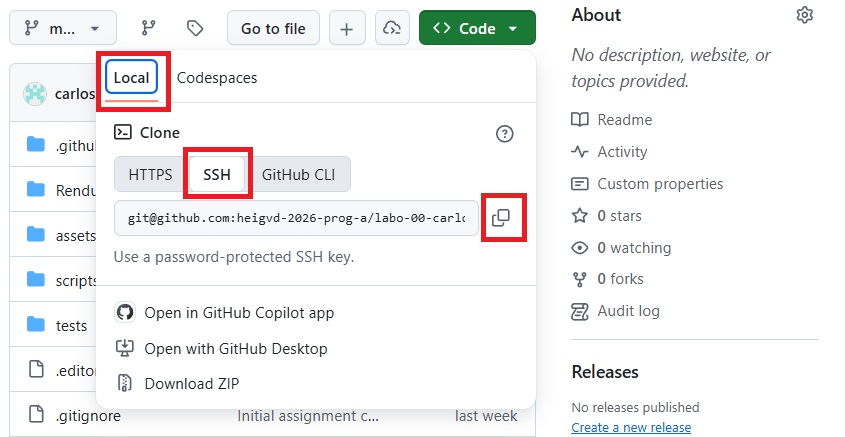
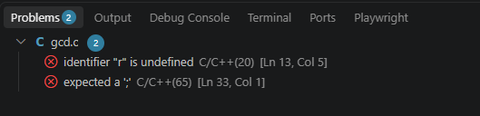
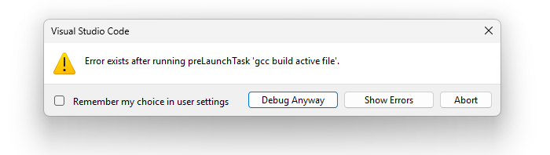
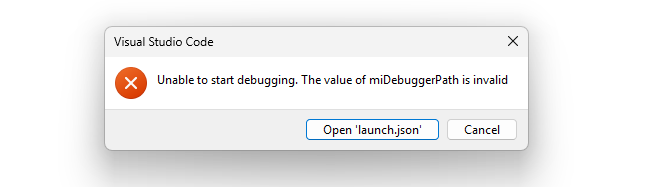
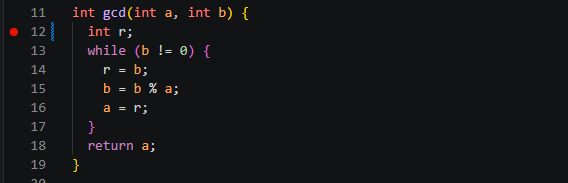
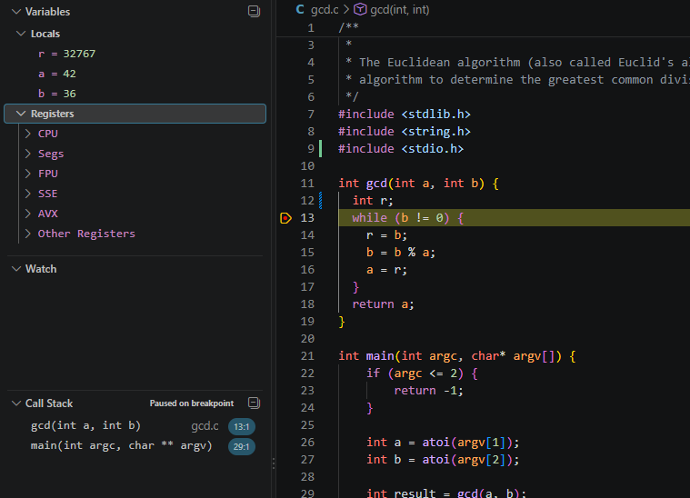

# 👋 Laboratoire 01 - Premiers pas

| Type       | Description                        |
| ---------- | ---------------------------------- |
| Durée      | 2x45 minutes + Travail à la maison |
| Rendu      | Sur GitHub                         |
| Format     | Travail individuel                 |
| Évaluation | Sur la fonctionnalité du code      |

Le but de ce travail pratique est la prise en main de l'environnement de développement (Visual Studio Code) et la compilation de votre premier programme. Plus nous avancerons dans les travaux pratiques, moins vous serez guidé. Pour l'heure, avançons pas à pas...

À la fin de ce travail pratique vous serez en mesure de :

- récupérer les fichiers sources d'un travail pratique depuis GitHub (*clone*) ;
- apporter vos modifications, ajouter des fichiers ;
- soumettre vos changements sur GitHub ;
- compiler votre programme ;
- le tester ;
- comprendre les différents fichiers constituant un projet d'Info1.

## Début d'un laboratoire

Tous les développeurs de la planète terre, utilisent majoritairement aujourd'hui l'outil Git pour gérer le code source de leurs projets. Git n'est rien d'autre qu'une base de données locale prenant place dans un dossier caché dans le dossier du projet et nommé `.git`.

| Rang | Système de gestion de version | Part d'utilisation |
| ---- | ----------------------------- | ------------------ |
| 1    | Git                           | 95%                |
| 2    | Subversion                    | 3%                 |
| 3    | Perforce                      | 1%                 |
| 4    | Mercurial                     | 1%                 |

Pour collaborer dans les années 1990, les développeurs s'envoyaient des e-mails ou des disquettes par la poste. Aujourd'hui on utilise plus volontiers des plateformes collaboratives qui intègrent Git. Les principales sont:

| Rang | Système de gestion de version | Part d'utilisation |
| ---- | ----------------------------- | ------------------ |
| 1    | GitHub                        | 78%                |
| 2    | GitLab                        | 12%                |
| 3    | BitBucket                     | 6%                 |
| 4    | Azure DevOps                  | 3%                 |
| 5    | Autre (Gitea, Forgejo...)     | 1%                 |

Pour faciliter l'organisation des laboratoires, la HEIG-VD a développé l'outil [HEIG-Classroom](https://classroom.chevallier.io). Il permet de distribuer les travaux pratiques, intéragir avec GitHub, de gérer les rendus et de corriger les travaux.

La première étape consiste donc à vous connecter sur HEIG-Classroom puis à accepter le laboratoire. La plateforme s'occupe de créer sur GitHub un *référentiel* sur lequel vous allez travailler. Il s'agit d'un espace cloud de stockage de fichiers et de code source. Vous pouvez y accéder depuis votre navigateur web.

Une fois sur GitHub, vous pouvez utiliser le bouton vert pour copier le lien du chemin pour cloner votre projet, c'est à dire le récupérer sur votre ordinateur :

1. Cliquez sur le bouton `<> Code`
2. Sélectionnez `Local`
3. Sélectionnez `SSH`
4. Cliquez sur le bouton `Copy` pour copier le lien dans votre presse-papier.



## Clone du référentiel

Lors du travail précédent, nous avons installé WSL (Linux) et Git. Donc à présent vous allez ouvrir un terminal Linux et utiliser la commande `git clone` suivie du lien copié depuis GitHub pour récupérer le projet sur votre ordinateur. Utilisez le bouton droit de la souris pour coller le lien. L'opération de clonage est illustrée ci-dessous :

```console
$ git clone https://github.com/heig-vd-tin/labo-01-yves-chevallier.git
Cloning into 'labo-01-yves-chevallier'...
remote: Enumerating objects: 8, done.
remote: Counting objects: 100% (8/8), done.
remote: Compressing objects: 100% (8/8), done.
remote: Total 8 (delta 0), reused 0 (delta 0), pack-reused 0
Unpacking objects: 100% (8/8), done.
```

Découpons un peu cette sortie pour mieux comprendre ce qui se passe. Le `$` au début de la ligne s'appelle le *prompt*, il indique que le terminal est prêt à recevoir une commande. `git` c'est le nom du programme que vous voulez appeler, `clone` c'est une sous commande de `git` et enfin le dernier argument c'est le chemin du projet que vous voulez cloner.

Une fois exécuté la commande vous informera de l'état d'avancement du clonage. Le point important c'est de constater que le dernier mot de la sortie est `done`. Cela signifie que tout s'est bien passé.

Une fois récupéré, rendez-vous dans le répertoire de votre projet en appelant la commande `cd` (*change directory*) suivie du nom du répertoire (indiqué dans la sortie de la commande précédente, ici `labo-01-yves-chevallier`).

Rendez-vous dans le répertoire :

```console
cd labo-01-yves-chevallier
```

> **Note**
> il vous suffit de faire `cd lab<tab><tab>` pour compléter automatiquement le reste du texte. C'est très pratique lorsque vous avez des noms de répertoires longs.

Depuis cette étape vous pouvez maintenant lancer votre éditeur de code (Visual Studio Code). N'oubliez pas le point `.` après le nom de la commande, il signifie *le répertoire courant* :

```console
code .
```

> La commande reçoit en argument la chaîne de caractère `.`. La commande ouvre donc VS Code dans le répertoire courant, celui du projet.

Visual Studio Code est démarré dans Windows puis connecté à votre WSL par le biais d'une connexion à distance (*remote connection*). En bas à gauche de la fenêtre de Visual Studio Code vous pouvez constater un petit logo vert indiquant l'état de la connexion à distance avec WSL par exemple `WSL: Ubuntu-26.04`. Lors du lancement vous observerez que votre éditeur de code se connecte à votre WSL:


*NOTE* : Si vous ne parvenez pas à obtenir cette connexion, c'est sans doute qu'il vous manque l'extension `WSL`. Installer cette extension depuis le menu `Extensions` de Visual Studio Code, puis redémarrer Visual Studio Code.

## Installation des extensions

Pour disposer de tout l'arsenal de développent en C/C++ il est nécessaire d'installer des extensions à votre éditeur Visual Studio si ce n'est pas déjà fait. Visual Studio Code est un outil très polyvalent et de nombreuses extensions ajoutant des fonctionnalités peuvent être installées au gré des besoins. Le raccourci `<CTRL>+<MAJ>+<X>` permet d'ouvrir le panneau d'installation des extensions. On vous propose l'installation des extensions suivantes :

**C/C++** Permet de mieux interagir avec du code C, il permet de s'interfacer avec un débogueur, d'avoir de l'autocomplétion de code et un correcteur interactif de syntaxe.

**clangd** Permet d'avoir de l'autocomplétion de code et un correcteur interactif de syntaxe.

**EditorConfig** Permet de configurer certaines options propres à chaque type de fichier (nombre de tabulation, type d'encodage, type de fin de ligne, etc.)

Le raccourci `<CTRL>+<MAJ>+<E>` permet de revenir à l'arborescence de travail.

## Familiarisation avec la structure des fichiers

Prenez connaissance de la structure des fichiers du labo ci-dessous. Vous pouvez obtenir ce type d'arborescence avec le programme `tree` depuis WSL. Ouvrez un terminal depuis vs-code avec le raccourci `<C-j>` puis tapez la commande `tree` :

```text
.
├── Makefile        # Les directives de compilation
├── README.md       # La donnée du laboratoire au format Markdown
├── assets          # Les images associées au README
├── gcd.c           # Le programme C à compléter / corriger
├── criteria.yml    # Les critères d'évaluation du travail
└── test            # Les éventuels tests du laboratoire
    └── test.sh     # Le test du programme gcd.c
```

> **NOTE** Si le programme `tree` n'est pas installé sur votre WSL, vous pouvez l'installer avec la commande suivante : `sudo apt install tree`

Pour l'instant, le seul fichier qui nous intéresse c'est `gcd.c`. Votre travail c'est de corriger ce programme et de le compiler.

Car oui, le programme qu'on vous a fourni ne compile pas, il contient de nombreuses erreurs:

- des erreurs de syntaxe ;
- des erreurs de logique ;
- des erreurs de style.

## Compilation

Depuis la console, essayer de compiler votre programme en utilisant le compilateur `gcc`. Vous constaterez quelques erreurs :

```bash
$ gcc gcd.c
gcd.c: In function ‘gcd’:
gcd.c:13:5: error: ‘r’ undeclared (first use in this function)
     r = b;
     ^
gcd.c:13:5: note: each undeclared identifier is reported only once for each
function it appears in
gcd.c: In function ‘main’:
gcd.c:30:5: warning: implicit declaration of function ‘printf’
[-Wimplicit-function-declaration]
     printf("%d\n", result + 5);
     ^~~~~~
gcd.c:30:5: warning: incompatible implicit declaration of built-in function ‘printf’
gcd.c:30:5: note: include ‘<stdio.h>’ or provide a declaration of ‘printf’
gcd.c:33:1: error: expected ‘;’ before ‘}’ token
```

Votre but c'est bien naturellement de corriger ces erreurs en essayant d'interpreter les erreurs. L'algorithme est donc assez simple :

1. Essayer de compiler ;
2. Corriger le programme, le sauver ;
3. Retour à (1) si échec.

Alternativement, vous pouvez aussi vous aider du tab `Problems` de Visual Studio Code qui liste les erreurs de compilation grace aux extensions que nous avons installées. Vous pouvez accéder à ce tab avec le raccourci `<CTRL>+<MAJ>+<M>`.



En double cliquant sur une erreur, vous serez directement amené à la ligne du code source qui pose problème.

## Compilation automatique

Habituellement on n'utilise pas `gcc` directement, on ajoute des **options de compilation**. Certaines options comme `-std=c11` permettent de dire au compilateur d'utiliser le standard **C11** (ISO 9899:2011). Pour simplifier la compilation, le développeur écrit un fichier nommé *Makefile* qui contient toute la procédure de compilation.

Dans ce cours il ne vous sera jamais demandé d'écrire un *Makefile* en revanche, il est essentiel que vous puissiez en utiliser un.

Pour l'utiliser, exécuter simplement le programme `make` dans un répertoire qui contient un `Makefile` :

```bash
$ make
cc -std=c11 -Wall -Werror gcd.c -o gcd
test/test.sh /mnt/c/Users/yves.chevalli/Dropbox/work/heig-vd/teaching/info/laboratories/info1-labo-01/gcd
Makefile:10: recipe for target 'test' failed
make: *** [test] Error 1
```

Vous constatez que le programme s'est bien compilé, mais qu'une erreur est apparue à la recette `test`. C'est-à-dire que le programme de test n'a pas fonctionné. Cherchons donc à savoir pourquoi.

Si l'on exécute le programme compilé avec `./` devant le nom du programme, vous obtenez ceci :

```bash
$ ./gcd 12 6
11
```

C'est étrange, le programme retourne 11 alors que le plus grand diviseur commun devrait être 6. Il doit y avoir un autre problème dans le programme.

Saurez-vous le trouver ?

Votre objectif est bien entendu d'arriver à lancer tous les tests.

## Debug depuis Visual Studio Code

Pour de petits programmes, compiler manuellement ou via un *Makefile* est une très bonne solution, mais pour de très gros programmes il existe d'autres techniques.

La première étape est de vous assurer que vous avez bien un débogueur installé sur votre système. Depuis le terminal (`<C-j>`) tentez d'installer `gdb` (GNU Debugger) avec:

```console
sudo apt install gdb
```

Dès à présent, depuis Visual Studio Code, vous pouvez utiliser le raccourci `<F5>` lorsque vous éditez le programme `gcd.c` pour lancer le débogueur.

Si vous rencontrez l'erreur suivante, c'est que votre programme ne compile toujours pas. Il faut donc corriger les erreurs de compilation avant de pouvoir utiliser le débogueur.



Si vous avez l'erreur suivante, c'est que vous n'avez pas installé le débogueur `gdb` sur votre WSL. Il faut donc l'installer avec la commande `sudo apt install gdb`.



Si tout se passe bien vous aurez la sortie suivante:

```text
Loaded '/lib64/ld-linux-x86-64.so.2'. Symbols loaded.
[Thread debugging using libthread_db enabled]
Using host libthread_db library "/usr/lib/x86_64-linux-gnu/libthread_db.so.1".

Breakpoint 1, main (argc=3, argv=0x7fffffffda08) at
/home/ycr/labo-01-first-steps/gcd.c:22
22	    if (argc <= 2) {
Loaded '/usr/lib/x86_64-linux-gnu/libc.so.6'. Symbols loaded.
[Inferior 1 (process 129149) exited normally]
The program '/home/ycr/labo-01-first-steps/gcd' has exited with code 0 (0x00000000).
```

Le `Loaded` indique que le débogueur a chargé les symboles de débogage du programme. Le `Breakpoint 1` indique que le débogueur s'est arrêté à la ligne 22 du fichier `gcd.c`. Le `The program ... has exited with code 0` indique que le programme s'est terminé normalement sans erreurs.

Maintenant, tout l'intérêt du débogueur est de pouvoir observer l'état des variables internes du programme. Pour cela, il faut placer un *breakpoint*, par exemple à la ligne 12 du fichier `gcd.c`. Pour ce faire, cliquez à gauche de la ligne 12, un point rouge apparaît. Il s'agit d'un *breakpoint*.



Essayez à nouveau d'invoquer le débogueur avec `<F5>`. Le programme s'arrête à la ligne 12. Vous pouvez observer l'état des variables `a`, `b`, `r` dans le panneau `Variables` à gauche de la fenêtre. Vous pouvez également observer l'état des variables en survolant le nom de la variable dans le code source.



Vous pouvez maintenant utiliser `<F11>` pour avancer pas à pas dans le programme et observer l'évolution des variables. Vous pouvez également utiliser `<SHIFT>+<F5>` pour interrompre le débogage et `<CTRL>+<SHIFT>+<E>` pour revenir à l'explorateur de code.

Cette méthode vous permet d'analyser le fonctionnement et de corriger les éventuelles erreurs de votre programme. Rappelez-vous du cours et de l'algorithme d'Euclide. Tentez de voir sur un papier quelle devrait être l'évolution de `a`, `b` et `r` à chaque itération de la boucle. Comparez ensuite avec ce que vous observez dans le débogueur.

Votre objectif est de corriger les erreurs restantes.

## Modifier les paramètres d'appel du programme

Vous l'aurez constaté, avec le débogueur le programme s'appelle avec 42 et 36. Vous pouvez modifier ces paramètres d'appel. Ouvrez le fichier `launch.json` avec `<CTRL>+<P>` puis tapez `launch.json` suivi de `<ENTER>`. Vous pouvez modifier les paramètres d'appel du programme dans la section `args` :

```json
"args": ["42", "36"],
```

Testez votre programme avec d'autres valeurs pour vous assurer que votre programme fonctionne correctement.

## Annotation de votre programme

Pour être bien certain que vous avez compris votre premier programme, il vous est demandé d'annoter chaque ligne avec un commentaire expliquant ce que chacune fait. Voici un exemple :

```c
#include <stdlib.h> // Inclus la bibliothèque stdlib pour pouvoir utiliser la fonction `atoi`

int gcd(int a, int b) { // Déclare la fonction gcd qui prend en paramètre
                        // 2 entiers a et b et retourne un entier
  int r; // Déclare une variable `r` qui est le reste de la division
```

Si vous souhaitez être plus précis, vous pouvez utiliser les commentaires multilignes :

```c
/*
Ceci est un commentaire multiligne
pour expliquer des choses plus longues
...
...
*/
```

Si vous ne comprenez pas bien certaines lignes de code, essayez de chercher la réponse sur internet, sinon demandez autour de vous.

## Commit de vos changements

Une fois que vous avez terminé toutes les étapes ci-dessus, vous pouvez soumettre vos changements sur GitHub. Pour ce faire, il faut d'abord valider vos changements avec un *commit*. Pour cela, utilisez la commande suivante depuis le terminal :

```console
$ git commit -am "Fix bugs + add comments"
[master abde12] Fix bugs + add comments
 1 file changed, 140 insertions(+), 1 deletion(-)
 create mode 100644 gcd.c
```

L'option `-a` demande à Git de tenir compte de toutes les modifications `all`, et l'option `-m` indique que l'argument qui suit est le commentaire associé à cet ensemble de modifications. La norme POSIX permet de concaténer les options `-am`.

Si la commande ne fonctionne pas chez vous, c'est que vous n'avez probablement pas configuré votre environnent Git convenablement et que vous avez oublié de saisir vos identifiants :

```console
git config --global user.name "Emmet Lathrop Brown"
git config --global user.email emmet.brown@heig-vd.ch
```

## Push de vos changements

Une fois le commit effectué, il faut encore soumettre vos changements sur GitHub, ceci s'effectue avec la commande `git push`

```console
$ git push
Counting objects: 25, done.
Delta compression using up to 8 threads.
Compressing objects: 100% (22/22), done.
Writing objects: 100% (25/25), 197.60 KiB | 2.53 MiB/s, done.
Total 25 (delta 4), reused 0 (delta 0)
remote: Resolving deltas: 100% (4/4), done.
To github.com:heig-vd-tin/info1-labo-01.git
   dd54203..e8d278e  master -> master
```

À présent vous pouvez retourner sur GitHub pour vérifier que votre rendu de labo est bel et bien présent.
